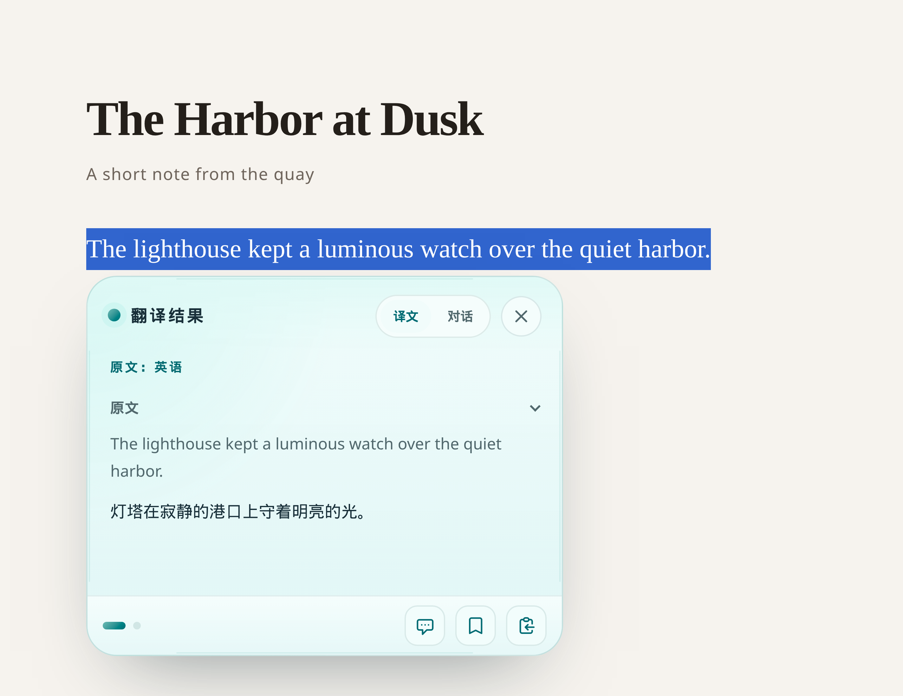
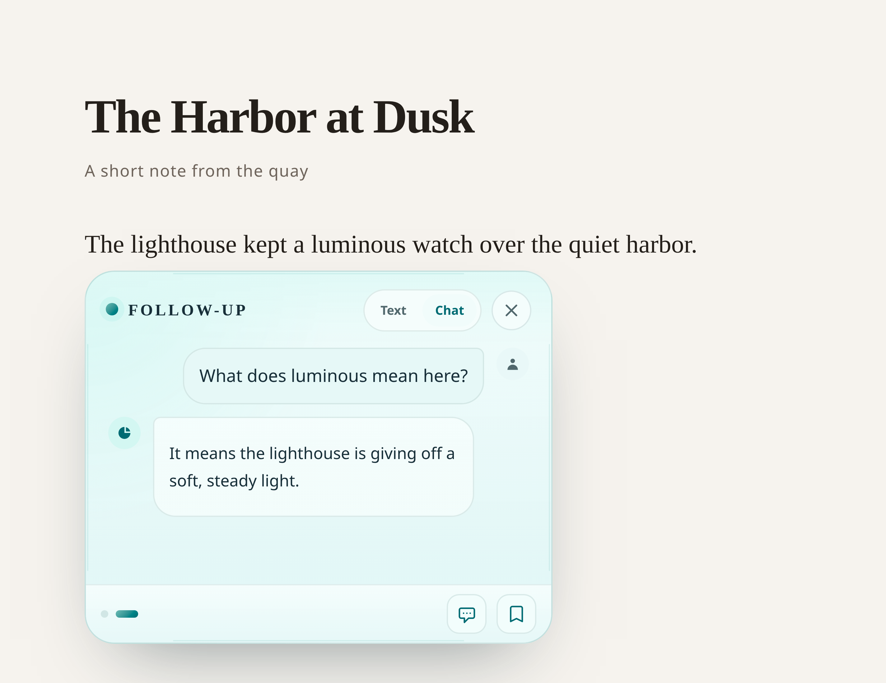
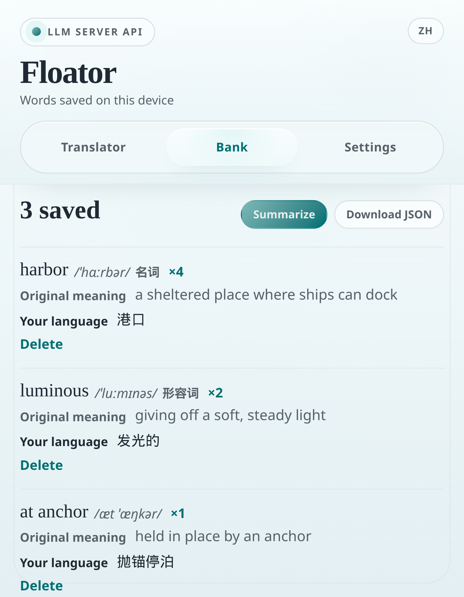

# 浮译 / Floator

[English](README.md)

为你正在阅读的页面提供悬浮翻译。

选中后指针悬浮，在原文下方即可弹出翻译卡片。可以复制结果、保存到词库或者直接在原地追问 AI 更多细节。

https://github.com/user-attachments/assets/70054edc-b62e-4263-bda0-f5434d951377

[](CHANGELOG.md)
[](src/manifest.ts)
[](LICENSE)

Floator 面向用另一种语言阅读网页、并希望就在这句话旁边看到意思的人。中文名是浮译，英文名是 Floator。

## 功能

**在页面上**

- 悬停选区即可翻译。等待时间可以设置，从 200 毫秒到 5 秒。
- 结果可以一次显示，也可以流式写入卡片。
- 支持源语言显示。识别不到时，卡片会标明自动检测。
- 支持 Markdown 渲染；在标准模式页面上，用 KaTeX 渲染数学公式。
- 在同一张卡片里追问用词、语气或上下文。发送后草稿会清空；请求失败时草稿会恢复。
- 可以拖动卡片，也可以调整大小。
- 保存选区。按住 Command 或 Ctrl 点击可切换单词，按住 Shift 点击可扩展短语。一次保存记下你选中的短语。
- 单个词可以保留词性。短语会保留整段短语的发音。

**在弹窗里**

- 翻译、词库和设置。
- 粘贴较长文本，选择目标语言，然后翻译、重新翻译、复制。
- 从当前译文继续 AI 对话，或直接开始一段对话。
- 「你的语言」是两段控件：左侧是 English，右侧是 中文、Français、Deutsch、Español、العربية、हिन्दी、Русский 或 Português。右侧语言始终是默认翻译目标。选择阿拉伯语时，弹窗和悬浮卡片从右向左排列。
- 词库列出保存在本机的词，按保存次数排序。到了复习时间会出现提醒。可以总结这些词、忽略提醒，或删除总结文本。
- 把词库下载为 JSON，或把复习内容下载为 Markdown。

**API**

- 任意兼容 OpenAI 的 Chat Completions 端点。
- 可以保存三个提供方：LLM 服务器（默认 OpenRouter）、LM Studio 和 Ollama。
- 预加载模型，可选开启模型保活，可选打印调试日志。
- 模型名包含 `translategemma` 时，Floator 使用 TranslateGemma 提示，并规范化语言代码。

## 截图







## 安装

先构建扩展，再加载 `dist/` 目录。

```bash
npm install
npm run build
```

1. 打开 `chrome://extensions`。
2. 打开开发者模式。
3. 选择**加载已解压的扩展程序**，并选中 `dist/`。

之后源码有改动时，重新运行 `npm run build`，再在该页面重新加载扩展。

## API 设置

打开弹窗，进入**设置**，选择提供方并保存。

| 提供方 | 常见端点 | 模型 |
| --- | --- | --- |
| LLM Server API | `https://openrouter.ai/api/v1` | `openrouter/free` |
| LM Studio | `http://127.0.0.1:1234/v1` | LM Studio 中已加载的模型 |
| Ollama | `http://127.0.0.1:11434/v1` | 例如 `qwen2.5:7b-instruct` |

API Key 按该服务器的要求填写。本机安装的 LM Studio 和 Ollama 通常接受一个占位符。OpenRouter 需要真实密钥。密钥保存在 Chrome 同步存储中，只会发送到你配置的端点。

Floator 会向 `{endpoint}/chat/completions` 发送请求，并在路径缺失时补上：

- 端点已经以 `/chat/completions` 结尾时，按原样使用
- 端点以 `/v1` 或 `/v4` 结尾时，补上 `/chat/completions`
- 其他情况补上 `/v1/chat/completions`

**预加载模型**会预热所选模型。**模型保活**会按你设置的间隔重复预热。两者都可选。调试日志需要手动开启。

## 开发

这是一个 Manifest V3 扩展：使用 React 和 TypeScript，由 Vite 与 CRXJS 插件打包。

```bash
npm install
npm run dev      # Vite，端口 5173
npm run lint
npm run build    # tsc -b && vite build
```

开发时把 `dist/` 作为已解压的扩展加载，每次构建后重新加载。源码在 `src/`：内容脚本在 `src/content`，弹窗在 `src/popup`，service worker 在 `src/background`。共享的配置、记忆和界面文案在 `src/lib`。

## 打包发布

```bash
npm run release
```

这条命令会构建 `dist/`，并在仓库根目录写出 `floator-<version>.zip`。Zip 文件列在 `.gitignore` 中。可以把该压缩包上传到 Chrome 网上应用店，或直接分享。

## 隐私与许可

哪些内容会离开浏览器，哪些留在本地存储，见 [PRIVACY.md](PRIVACY.md)。

Floator 以 [Apache-2.0](LICENSE) 许可发布。

## 里程碑

- **2026-02-06** — 1.0.1，首次发布
- **2026-03-13** — 1.1.0，Floator / 浮译 品牌
- **2026-10-13** — 1.2.0，本机词库

各版本的变更记录见 [CHANGELOG.md](CHANGELOG.md)。
